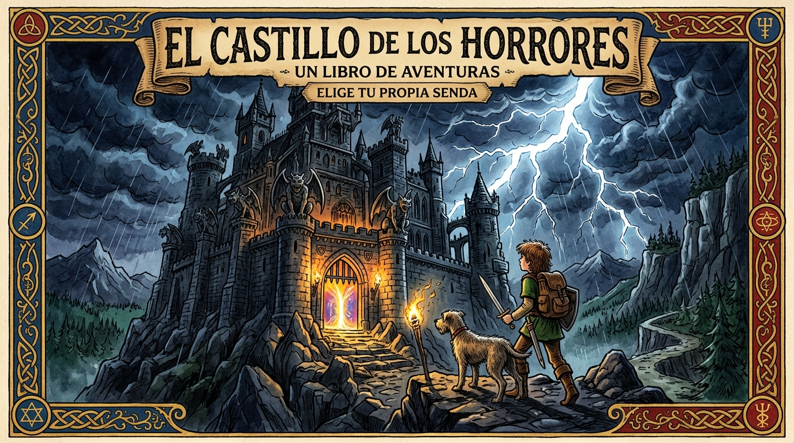

# 🏛️ Biblioteca Fantástica de Aventuras

Una plataforma interactiva de **libros-juego ilustrados** (estilo "Elige tu propia aventura" con enigmas visuales, laberintos, acertijos y decisiones ramificadas).

## 📚 Libros Disponibles

1. 🏰 **Sombras en la Fortaleza Prohibida (El Castillo de los Horrores):** Infiltración, laberinto de catacumbas, banquete trampa, armería y combate de dados contra el monstruo eléctrico.
2. 🎪 **El Circo de los Horrores y las Ilusiones:** Magia de circo, laberinto de espejos, jaulas mecánicas y búsqueda de los sellos.
3. ⏳ **La Cueva del Tiempo y los Portales Perdidos:** Portales dimensionales (Prehistoria, Egipto, Medievo, Futuro) y pruebas de señalar en el mapa.
4. 🐲 **El Castillo Medieval y el Dragón Dormido:** Sigilo en las almenas, reactivos alquímicos y rescate de la corona real.
5. 🎈 **El Mundo Imaginario y las Islas Flotantes:** Navegación en barco aéreo, molinos de cristal y el gran faro celeste.

## 🚀 Cómo Jugar

- **Online en GitHub Pages:** *(El enlace se activa en Settings > Pages)*
- **En Local:** Abre [`index.html`](index.html) o entra en [`web_app/index.html`](web_app/index.html) con tu navegador habitual.
